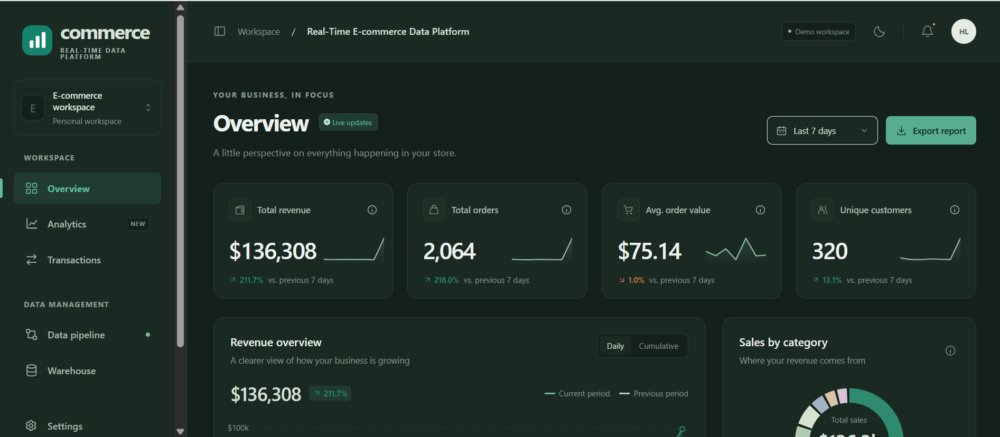

# Real-Time E-commerce Data Platform

A responsive commerce dashboard with a supported production data path: authenticated Node.js services, PostgreSQL storage, protected transaction ingestion, and an optional Kafka consumer.

## Dashboard preview



*Dashboard preview using demo data.*

## Local development

Use **Node.js 24 LTS**. From this project directory:

```sh
npm ci --ignore-scripts
npm start
```

Development defaults to clearly labeled sample data and does not require Docker or PostgreSQL.

```sh
npm run dev      # Watch server source changes; reload the browser for frontend changes
npm run check    # Syntax checks for application, scripts and tests
npm test         # Unit, SQL, authentication and security tests
```

## Production

Read **[PRODUCTION.md](PRODUCTION.md)** for the complete deployment and operations guide.

```sh
npm run secrets:setup
cp .env.production.example .env.production
# Set DOMAIN and ADMIN_USERNAME in .env.production.
docker compose --env-file .env.production -f compose.production.yml up -d --build
```

The deployment provides HTTPS through Caddy, a non-root app container, a private PostgreSQL service, versioned migrations, a restricted database role, persistent sessions, health checks, resource limits and bounded logs. Production requires real PostgreSQL data and valid secrets; it will not silently use demo data.

Production starts with an empty warehouse. Submit real events through the protected ingestion API or enable the Kafka worker profile. The original Python / Spark / dbt / Airflow files remain legacy references and are not part of the supported production deployment.

## Dashboard

- **Overview:** revenue, order volume, average order value, distinct customers, comparisons, categories, recent transactions and top products.
- **Analytics:** daily/cumulative charts, country revenue, payment methods and product rankings.
- **Transactions:** search, category/status filters, sorting, pagination, details, bounded CSV exports and live update controls.
- **Data pipeline:** the actual data path, observed database health and warehouse change notifications.
- **Warehouse:** the production schema and storage mode.
- **Settings:** browser-local display preferences, theme, reporting period and update preference. Production includes sign-in and session revocation through Sign out.

The interface supports desktop and phone layouts, keyboard navigation, reduced motion and locally served assets.

## Data contract and metric definitions

Revenue includes completed transactions only. Average order value divides completed revenue by completed order count. Order counts include every status; customer counts use distinct customer IDs. Comparisons use the previous period of equal duration. Reporting windows are rolling 1/7/30 days, and all amounts are USD.

Production records are stored in PostgreSQL with exact monetary decimals, idempotent immutable event IDs and indexed reporting filters. Validations reject inconsistent prices, unsupported status/payment values, invalid dates and conflicting duplicates. SQL aggregation avoids loading the entire warehouse into application memory. Filters and export limits apply at the server.

Development seeds roughly 5,000 fictional events over 60 days and adds one every 6.5 seconds. Sample records reset on restart. Theme and display preferences remain in the browser. Production and demo modes are labeled separately throughout the UI.

## Verification and release

Tests exercise login/logout, CSRF rejection, persistent sessions, restricted APIs, rate limiting, query validation, SQL injection resistance, migrations, duplicate/conflicting ingestion, atomic rollback, SQL revenue calculations, exports, security headers, SSE limits and readiness failures. Local SQL tests use the PGlite PostgreSQL engine; set `TEST_DATABASE_URL` to run against a PostgreSQL server instead. Tests isolate temporary schemas and require schema-creation permission on the test database.

GitHub Actions runs these checks against PostgreSQL 17, audits production dependencies, validates Compose, builds the image and smoke-tests production startup. Dependency update configuration is included. CI runs after you push this source to a repository with Actions enabled.

## Structure

```text
dashboard/
  server.mjs              HTTP, authentication, rate limits, API, CSV and SSE
  config.mjs              Validated environment and secret-file configuration
  security.mjs            Password hashing, sessions, JSON and origin checks
  validation.mjs          Transaction and query validation
  repositories/           PostgreSQL and development demo adapters
  migrations/             Versioned PostgreSQL migrations
  worker.mjs              Optional TLS/SASL Kafka consumer and quarantine
  scripts/                Setup, migration, ingestion and verification commands
  public/                 Dashboard and login UI
  test/                   Unit, SQL and production API tests
compose.production.yml    Supported Docker deployment
Dockerfile                Non-root Node 24 runtime
PRODUCTION.md             Setup, operations, backup, restore and release guide
deploy/                   TLS proxy and database role initialization
.github/                  CI and dependency update configuration
```

The legacy `docker-compose.yml` is development-only and binds services to loopback. It requires a database password in the environment. The production Compose file uses generated secrets and exposes only the HTTPS proxy.

## License

[MIT](LICENSE)
